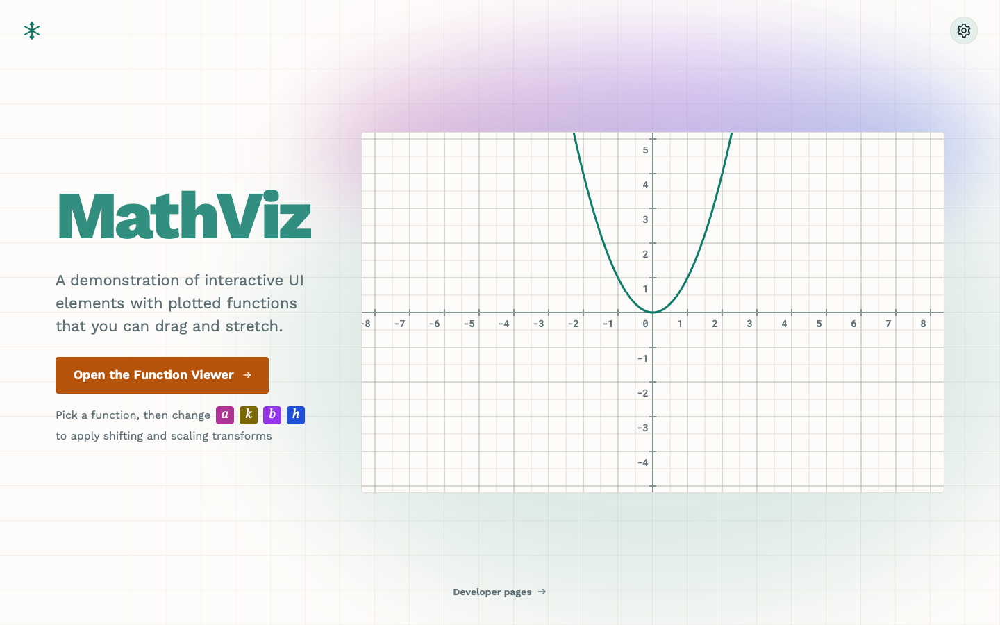

# MathViz

Interactive math visualizations for the browser, built with React, TypeScript and Vite.

### [Open the live demo →](https://niels4.github.io/math-viz/)

<a href="https://niels4.github.io/math-viz/">
  <picture>
    <source media="(prefers-color-scheme: dark)" srcset=".github/readme/welcome-dark.png">
    
  </picture>
</a>

**[Function Viewer](https://niels4.github.io/math-viz/#function-viewer):** pick a function, then drag its handles or scrub a, b, h and k to stretch and shift the curve. Pan and zoom the plane.

## How I built it

I combined my prototyping skills with AI tools to speed up both design and development. The [developer pages](https://niels4.github.io/math-viz/#dev) walk through each phase:

| Phase                                                             | What happened                                                                        |
| ----------------------------------------------------------------- | ------------------------------------------------------------------------------------ |
| [Concept](https://niels4.github.io/math-viz/#dev/concept)         | An image model drew galleries of concept art; six pictures set the visual direction  |
| [Fonts](https://niels4.github.io/math-viz/#dev/fonts)             | Test pages set each candidate font in the app's own strings                          |
| [Colors](https://niels4.github.io/math-viz/#dev/colors)           | Generated themes, checked for contrast; six kept, three light and three dark         |
| [Prototype](https://niels4.github.io/math-viz/#dev/prototype)     | A React prototype for behavior that is hard to describe in a spec                    |
| [Figma](https://niels4.github.io/math-viz/#dev/figma)             | A UX agent designed 13 rounds in Figma, then merged the best ideas into one design   |
| [Development](https://niels4.github.io/math-viz/#dev/development) | I set the architecture, an AI coding agent matched the styles, and I hunted the jank |

## Rust port

[math-viz-rust](https://github.com/niels4/math-viz-rust) is the obligatory AI port to Rust: one codebase that builds the Function Viewer as a native desktop app on SDL3 and as a WebAssembly app for the browser. **[Try it live](https://niels4.github.io/math-viz-rust/)**

## Running it

```sh
npm install
npm run dev     # dev server
npm test        # lint, type check and tests
npm run build   # static site in docs/
```

MIT licensed.
